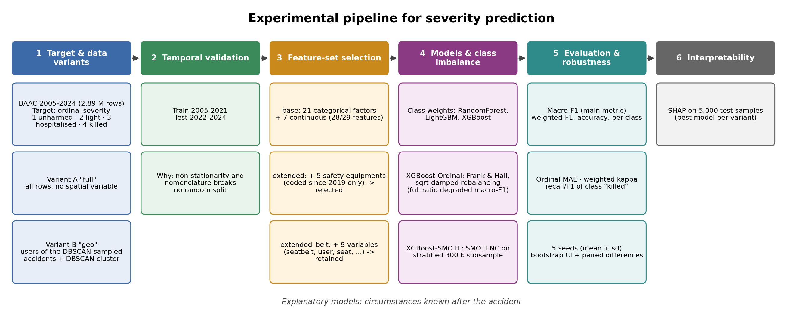

# Multi-task machine learning for road-accident analysis — French BAAC data (2005–2024)

Code, results and experiment log accompanying the paper *"A multi-task machine-learning
approach for road-accident analysis: a study on BAAC data (2005–2024)"*.

The pipeline addresses three objectives on the national French road-accident database (BAAC):

1. **Risk-factor identification** — correlations, PCA, association rules (Apriori / FP-Growth), heat calendars.
2. **Spatio-temporal segmentation of high-risk zones** — DBSCAN, HDBSCAN, ST-DBSCAN (two temporal definitions), exposure normalisation.
3. **Severity prediction** — 4-level ordinal target (unharmed < light injury < hospitalised < killed), five models,
   temporal validation, ordinal and SMOTENC variants, robustness protocol, SHAP.



## Repository layout

```
├── README.md                  this file
├── EXPERIMENTS.md             every experiment, its motivation, its results and the decision taken
├── requirements.txt
├── config.py                  all paths and parameters (single source of truth)
├── baac/
│   ├── common.py              logging, dataset loading, severity encoding
│   └── prediction.py          features, models (ordinal, SMOTENC), metrics, SHAP
├── scripts/
│   ├── 00_data_overview.py        inventory of raw files, column evolution, missing values
│   ├── 01_preprocessing.py        harmonisation, join, cleaning, feature engineering, imputation
│   ├── 02_risk_factors.py         correlations, PCA, association rules, heat calendars
│   ├── 03_spatial_segmentation.py DBSCAN / HDBSCAN / ST-DBSCAN, exposure normalisation
│   ├── 04_severity_prediction.py  5 models x 2 variants, confusion matrices, SHAP
│   ├── 05_robustness.py           seeds, ordinal metrics, bootstrap and paired bootstrap
│   └── make_pipeline_figure.py    the overview figure above
├── data/
│   ├── README.md              where to get the data, data dictionary, how to place it
│   ├── raw/                   original BAAC CSV files, one folder per year
│   └── processed/             cleaned dataset, produced by step 01
├── run_all.py                 whole pipeline in one command
├── run_extra.py               complementary runs (ordinal SHAP, `base` and `extended` feature sets)
├── results/                   final tables (overview, risk_factors, spatial, prediction/<feature_set>, robustness) and run logs
└── figures/                   pipeline overview, confusion matrices, SHAP, PCA, heat calendars, clustering maps
```

## Quick start

```bash
git clone https://github.com/helalaoui-uca/baac-road-safety-pipeline && cd baac-road-safety-pipeline
python -m venv .venv && source .venv/bin/activate        # Windows: .venv\Scripts\activate
pip install -r requirements.txt
```

1. Download the BAAC yearly files (see [`data/README.md`](data/README.md)) into `data/raw/<year>/`.
2. Run the steps in order:

```bash
python scripts/00_data_overview.py          # optional audit of the raw files
python scripts/01_preprocessing.py          # builds data/processed/ (several hours for 20 years)
python scripts/02_risk_factors.py           # add --skip-rules to skip the costly rule mining
python scripts/03_spatial_segmentation.py   # produces the DBSCAN clusters used by step 04
python scripts/04_severity_prediction.py    # --variants geo for a quick run; --feature-set base to compare
python scripts/05_robustness.py             # seeds + bootstrap (default: geo variant, 3 models, 5 seeds)
```

Outputs go to `outputs/<step>/` (do not commit them; the final ones are copied to `results/` and `figures/`). Paths can be relocated with the `BAAC_ROOT`
environment variable. Every step can be run on its own once its inputs exist, and
`scripts/04_severity_prediction.py` merges new results into existing CSVs, so re-running a single
model (`--models XGBoost-Ordinal --variants geo`) does not erase the others.

## Main results (feature set `extended_ceinture`, called `extended_belt` in the paper; test years 2022–2024)

The final run uses the corrected vehicle join: **2,887,353 user records** (2005–2024).
Macro-F1 is the reference metric (the four classes are strongly imbalanced). Full tables,
per-class metrics and the experiment history are in [`EXPERIMENTS.md`](EXPERIMENTS.md).

| Variant | Model | Macro-F1 | Weighted-F1 | Accuracy | Ordinal MAE | Weighted kappa |
|---|---|---|---|---|---|---|
| geo | XGBoost-SMOTE | **0.524** | **0.658** | **0.661** | **0.395** | 0.593 |
| geo | XGBoost-Ordinal | 0.523 | 0.643 | 0.646 | 0.424 | **0.594** |
| geo | XGBoost | 0.516 | 0.645 | 0.635 | 0.450 | 0.583 |
| geo | LightGBM | 0.513 | 0.642 | 0.630 | 0.463 | 0.576 |
| geo | Random Forest | 0.495 | 0.625 | 0.615 | 0.496 | 0.540 |
| full | XGBoost-SMOTE | **0.516** | **0.653** | **0.660** | **0.397** | 0.580 |
| full | XGBoost-Ordinal | 0.515 | 0.639 | 0.644 | 0.433 | **0.594** |
| full | XGBoost | 0.495 | 0.634 | 0.621 | 0.490 | 0.564 |
| full | LightGBM | 0.489 | 0.630 | 0.614 | 0.505 | 0.555 |
| full | Random Forest | 0.466 | 0.611 | 0.599 | 0.536 | 0.522 |

Over five seeds (geo variant), XGBoost-Ordinal and XGBoost-SMOTE are statistically
indistinguishable on macro-F1 (0.521 ± 0.003 vs 0.524 ± 0.001; paired-bootstrap difference −0.0007, 95 % CI [−0.005; +0.004], p = 0.79) but differ elsewhere:
XGBoost-SMOTE has the best accuracy, weighted-F1 and ordinal MAE (0.394), whereas XGBoost-Ordinal detects far more fatal
users (recall 0.38 vs 0.19; F1 *killed* 0.267 vs 0.216). Both beat plain XGBoost on macro-F1.

## Important caveats

* **The models are explanatory, not pre-accident predictors.** Some circumstance variables
  (collision type, obstacle struck, ...) are only known once the accident has happened.
* The *killed* class stays hard: precision is about 0.20 for the best models, i.e. four alerts out of five are false.
* **"geo" variant.** The spatial cluster comes from DBSCAN run on a random sample of the geolocated
  accidents (`DBSCAN_SAMPLE_SIZE = 150,000` accidents by default). The "geo" variant therefore contains the
  users of those sampled accidents (339,326 rows in the reported run), not every geolocated accident.
  `full` and `geo` are evaluated on different test sets, so comparing them is indicative only.
* Hyper-parameters were deliberately bounded for memory (single-core, strongly subsampled trees) and
  were **not** tuned. A `powerful` profile exists in `config.py` but was not used for any reported result.

## Run everything in one command

```bash
pip install -r requirements.txt
python run_all.py --raw-dir "C:\path\to\raw_csv_folder"
```

Finished steps are skipped on re-run (`--force` to recompute, `--steps 4 5` to pick steps, `--with-base` to add the base feature set, `--quick` for a fast test). Log: `outputs/run_all.log`.

## Vehicle join (fixed)

For 2005–2018 users and vehicles share the key `Num_Veh`; from 2019 they share `id_vehicule`.
An earlier version joined pre-2019 users to vehicles on `num_acc` only, which duplicated rows
(confirmed on 2016: 257,286 rows instead of 133,422 users). Two further sources of duplication were found
and fixed: multi-row `lieux` records for 2023–2024, and a parquet folder that was appended to instead of rewritten.
Step 01 now joins on the full key (`JOIN_ON_NUM_VEH = True`), keeps one row per accident in `carac`/`lieux`,
asserts one row per user, and `baac.common.load_master` checks the parquet row count. All results in this
repository come from the corrected dataset (2,887,353 rows).

## Data availability

The cleaned dataset is not stored in this repository (about 2.9 million rows, far above GitHub's
100 MB per-file limit). See [`data/README.md`](data/README.md) for how to rebuild it from the public
BAAC files, and for the place to put an archived copy (e.g. Zenodo DOI: *to be added*).

## Citation

> *To be completed after publication.* Repository: https://github.com/helalaoui-uca/baac-road-safety-pipeline
